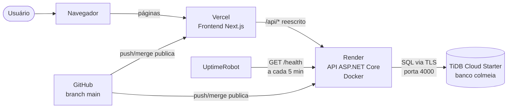

# Arquitetura de publicação e manutenção

Este documento explica como o Registro Colmeia está publicado e como mantê-lo funcionando. Para publicar do zero, use o [TutorialPrimeiroDeploy.md](TutorialPrimeiroDeploy.md).

## 1. Acesso às contas

Em todos os serviços usados na publicação (GitHub, TiDB Cloud, Render, Vercel e UptimeRobot), o login foi feito com a **conta Google criada para o projeto**. Para entrar em qualquer um deles, use "Continuar com Google" com essa conta.

**Para ter acesso à conta Google do projeto, entre em contato com os professores responsáveis pelo projeto de extensão.**

Regras:
- Não crie contas pessoais nesses serviços para administrar o sistema. Tudo deve ficar na conta do projeto, para que o acesso passe de uma turma para outra sem perda.
- Não compartilhe a senha da conta, a senha do banco ou a chave JWT por chat ou e-mail.
- Ao deixar o projeto, avise os professores, para que decidam se a senha da conta deve ser trocada.

| Serviço | Para que serve | Endereço |
|---|---|---|
| GitHub | Código-fonte (organização `abelhassenai`, repositório `RegistrosSaude`) | https://github.com/abelhassenai/RegistrosSaude |
| Vercel | Hospeda o frontend (Next.js) | https://vercel.com |
| Render | Hospeda o backend (API .NET em Docker) | https://dashboard.render.com |
| TiDB Cloud | Banco de dados (compatível com MySQL) | https://tidbcloud.com |
| UptimeRobot | Chama o backend a cada 5 minutos para ele não dormir | https://uptimerobot.com |

Todos estão em planos gratuitos, configurados sem cartão de crédito. Se algum serviço pedir cartão, não cadastre sem falar com os professores.

## 2. Arquitetura



Como uma requisição percorre o sistema:

1. O navegador abre o site no endereço do Vercel. O Vercel entrega as páginas do Next.js.
2. As páginas chamam a API sempre por caminhos `/api/...` no próprio endereço do Vercel. O Next.js reescreve essas chamadas para o backend no Render, usando a variável `API_INTERNAL_URL` (configurada em `frontend/next.config.ts`). Por isso navegador e API ficam na mesma origem e não é preciso configurar CORS em produção.
3. O backend no Render (container do `backend/Dockerfile`, porta 8080) valida o login com JWT e consulta o banco pelo Entity Framework Core (provider Pomelo).
4. O banco fica no TiDB Cloud. A conexão é pela internet, com TLS obrigatório (`SslMode=Required`).

### Diferença entre produção e ambiente local

| | Local (`docker compose up`) | Produção |
|---|---|---|
| Frontend | container Next.js | Vercel |
| Backend | container .NET | Render |
| Banco | MariaDB 11 (container) | TiDB Cloud Starter |
| Entrada | Nginx na porta 80 (separa `/api/*` e páginas) | Vercel (reescreve `/api/*`) |

O backend é o mesmo nos dois ambientes. As migrations precisam funcionar no MariaDB e no TiDB (ver seção 5.3).

### Configuração (variáveis de ambiente)

Os segredos ficam só nos painéis dos serviços, nunca no repositório. Os valores em `appsettings*.json` e `docker-compose.yml` são apenas para desenvolvimento local.

| Variável | Onde fica | O que é |
|---|---|---|
| `ConnectionStrings__Default` | Render | Connection string do TiDB (host, usuário, senha, `SslMode=Required`) |
| `Jwt__Key` | Render | Chave que assina os tokens de login (32+ caracteres) |
| `ASPNETCORE_ENVIRONMENT` | Render | `Production` |
| `PORT` | Render | `8080` |
| `API_INTERNAL_URL` | Vercel | URL do backend no Render, sem barra no final. Lida durante o build |

## 3. Publicação automática

- Render e Vercel estão ligados à branch **`main`** do GitHub. Cada merge na `main` gera um novo deploy nos dois, sem ação manual.
- No Render, o backend só passa a receber tráfego depois que o health check (`/health`) responde. Se o deploy novo falhar, a versão anterior continua no ar.
- Ao iniciar, o backend aplica sozinho as migrations pendentes do banco (`db.Database.Migrate()` em `Program.cs`). Se uma migration falhar, o backend não sobe e o erro aparece nos logs do Render.

## 4. Limites dos planos gratuitos

| Serviço | Limite | Consequência |
|---|---|---|
| Render Free | Dorme após 15 minutos sem acesso; 750 horas de instância por mês por conta | O UptimeRobot evita que durma. Um único serviço ligado o mês inteiro cabe nas 750 horas. **Não crie outro serviço gratuito na mesma conta**, senão as horas acabam antes do fim do mês |
| Render Free | Rollback só para os dois deploys anteriores | Ver seção 5.2 |
| TiDB Cloud Starter | 5 GiB de armazenamento e 50 milhões de Request Units por mês, por instância | Muito acima do uso atual. O consumo aparece no painel da instância |
| TiDB Cloud Starter | Backup automático diário, guardado por **1 dia**; não há backup manual | Ver seção 5.4 |
| Vercel Hobby | Uso não comercial; não permite adicionar colaboradores | Por isso todos usam a conta do projeto |

## 5. Manutenção

### 5.1 Publicar uma alteração

1. Crie uma branch a partir da `develop` (por exemplo, `feature/nome-da-mudanca`).
2. Faça as alterações e teste localmente (`docker compose up --build`, `dotnet test` em `backend/ColmeiaApi.Tests`, testes do frontend).
3. Abra um PR para a `develop` e faça o merge.
4. Quando quiser publicar, abra um PR da `develop` para a `main` e faça o merge.
5. Acompanhe o deploy na aba **Logs** do Render e na aba **Deployments** do Vercel.
6. Confira o site e o `https://<url-do-render>/health`.

### 5.2 Desfazer uma publicação com problema

- **Render:** em *Deploys*, escolha um deploy anterior que funcionava e clique em **Rollback**. No plano gratuito só dá para voltar para os dois deploys anteriores. O rollback pelo painel **desliga o deploy automático**: depois de corrigir o problema, religue em *Settings* do serviço.
- **Vercel:** na página do projeto, use **Instant Rollback** no quadro do deploy de produção. No plano Hobby só dá para voltar para o deploy imediatamente anterior. Depois do rollback, novos merges na `main` não entram no ar sozinhos: para voltar ao normal, clique em **Manage** no mesmo quadro e promova um deploy.
- **Atenção:** o rollback volta o código, mas **não desfaz alterações no banco**. Se a publicação aplicou uma migration, a estrutura nova continua no banco. Por isso a seção 5.3 pede cuidado com migrations.
- Depois do rollback, corrija o problema no código e publique de novo pelo fluxo da seção 5.1.

### 5.3 Alterar o banco (migrations)

1. Altere os modelos e o `ColmeiaContext` e gere a migration com `dotnet ef migrations add NomeDaMudanca` (em `backend/ColmeiaApi`).
2. Revise o arquivo gerado:
   - colunas `Guid` (`char(36)`) devem usar `ascii_bin`. O TiDB rejeita `ascii_general_ci`, e a migration falha em produção;
   - SQL escrito à mão em `migrationBuilder.Sql(...)` precisa funcionar no MariaDB e no TiDB.
3. Teste a migration nos dois bancos antes de publicar: no MariaDB do `docker compose` e num TiDB local (instruções em [TutorialPrimeiroDeploy.md](TutorialPrimeiroDeploy.md), seção 1.5).
4. Antes de publicar uma migration que apaga ou altera dados, exporte os dados de produção (seção 5.4).

### 5.4 Backup dos dados

O TiDB faz um backup automático por dia, mas no plano gratuito ele só fica guardado por 1 dia, e a restauração cria uma instância nova (com outro host e outro usuário, que precisam ser atualizados no Render). Esse backup serve para acidentes descobertos no mesmo dia, não como histórico.

Para ter uma cópia própria, exporte os dados periodicamente e antes de mudanças arriscadas:
- pelo painel do TiDB, na instância, em **Data > Export** (o arquivo exportado é baixado com o TiDB Cloud CLI, conforme a [documentação de exportação](https://docs.pingcap.com/tidbcloud/serverless-export));
- ou com a ferramenta Dumpling, conforme a [documentação da PingCAP](https://docs.pingcap.com/tidbcloud/export-data-from-tidb-cloud/).

Guarde os arquivos exportados no Google Drive da conta do projeto. Eles contêm dados pessoais (nome, CPF e e-mail dos usuários), então não os coloque no repositório.

### 5.5 Usuários e administradores

- **Aprovar ou recusar cadastros:** área **/admin** do site, com uma conta de admin.
- **Tornar alguém admin:** pela área de administração, ou no **SQL Editor** do TiDB:

```sql
UPDATE colmeia.Usuario SET permissao = 'Admin', aprovado = 1 WHERE email = 'email@exemplo.com';
```

- **Cadastro sem instituições:** a lista de instituições do formulário vem dos nomes das colmeias cadastradas. Se não houver colmeias, ninguém consegue se cadastrar pelo site. Cadastre colmeias em **/admin/colmeias**. Se o banco estiver vazio e não houver admin, siga a seção 4 do tutorial de primeiro deploy.

### 5.6 Trocar senhas e chaves

- **Senha do banco:** no TiDB, *Connect > Reset Password* (ou *Generate Password*). Atualize a senha na variável `ConnectionStrings__Default` do Render. Ao salvar, o Render faz um novo deploy sozinho. Até o deploy terminar, o backend fica sem conseguir acessar o banco.
- **Chave JWT:** gere uma nova (comando no tutorial, passo 2) e atualize `Jwt__Key` no Render. Todos os usuários serão desconectados e precisarão fazer login de novo.
- Troque as duas sempre que houver suspeita de vazamento, por exemplo se apareceram num chat, print ou commit.

### 5.7 Mudar a URL do backend

Se o serviço do Render for recriado ou mudar de nome, a URL muda. Então:
1. Atualize `API_INTERNAL_URL` no Vercel (sem barra no final).
2. Faça um novo deploy no Vercel (*Deployments > Redeploy*). Só salvar a variável não basta, porque ela é lida no build.
3. Atualize a URL do monitor no UptimeRobot.

### 5.8 Acompanhar o funcionamento

- **UptimeRobot:** envia e-mail para a conta do projeto quando o `/health` para de responder.
- **Render > Logs:** erros do backend (falha de conexão com o banco, exceções, migrations).
- **Vercel > Deployments / Logs:** erros de build e do frontend.
- **TiDB > instância:** consumo de armazenamento e Request Units no mês.

## 6. Problemas comuns

| Sintoma | Causa provável | O que fazer |
|---|---|---|
| Site demora cerca de 1 minuto para responder | Backend do Render dormindo | Conferir se o monitor do UptimeRobot está ativo e **Up** |
| Login ou cadastro dá erro 500 | Backend sem acesso ao banco | Ver *Render > Logs*. Conferir a connection string e a senha no Render, e a regra de firewall `Allow_all_public_connections` no TiDB |
| Deploy do Render falha logo ao iniciar | Migration com erro ou variável faltando | Ler o erro nos logs. Para migration, ver seção 5.3 |
| Erro `Unsupported collation ... 'ascii_general_ci'` | Migration nova com collation incompatível com o TiDB | Trocar por `ascii_bin` na migration (seção 5.3) |
| Páginas abrem, mas nenhum dado carrega | `API_INTERNAL_URL` errada ou sem novo deploy no Vercel | Seção 5.7 |
| Formulário de cadastro sem instituições | Nenhuma colmeia cadastrada | Seção 5.5 |
| Ninguém consegue fazer login após troca de chave | `Jwt__Key` foi trocada | Normal: todos precisam entrar de novo |
| `dotnet run` falha localmente com "Uma política de Controle de Aplicativo bloqueou este arquivo" | O Windows bloqueou o `ColmeiaApi.exe` gerado no build | Rodar `dotnet bin\Debug\net9.0\ColmeiaApi.dll` de dentro de `backend\ColmeiaApi`, ou usar o `docker compose` |
